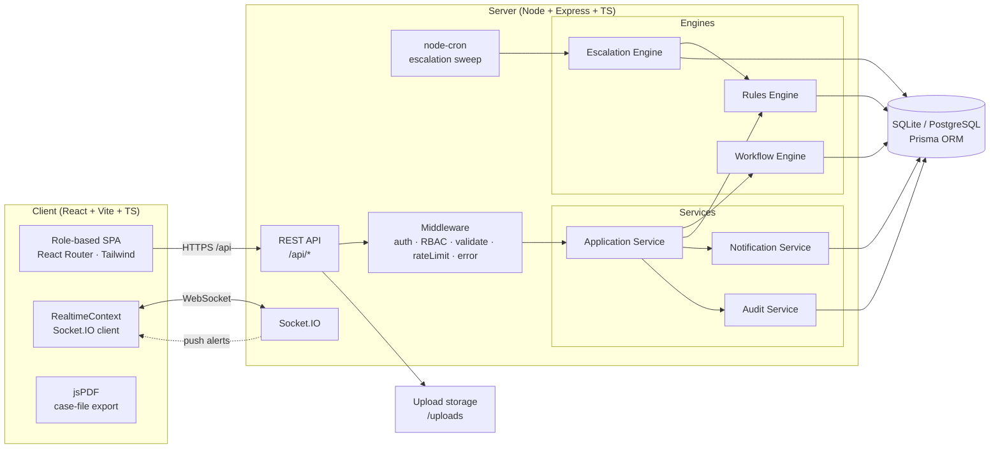
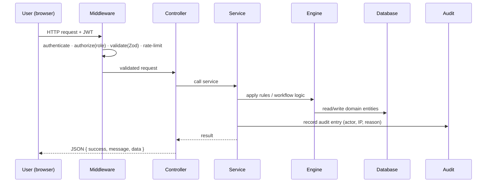
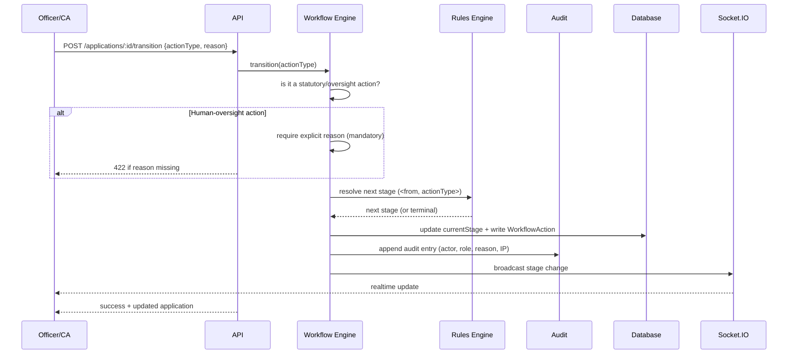
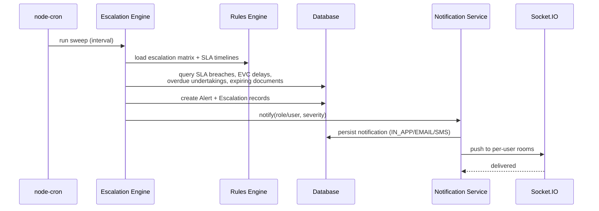
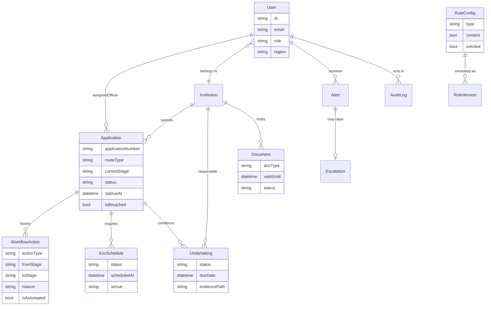

# Architecture — SIH 26262

This document describes the system architecture, the core request flows and the domain model
of the AICTE Approval Workflow Automation platform.

---

## 1. System Overview

---

## 2. Request Lifecycle

---

## 3. Workflow Transition (with Human-Oversight Gate)

---

## 4. Escalation Sweep (scheduled)

---

## 5. Domain Model (overview)

---

## 6. Roles & Access (RBAC)

| Role | Typical access |
|---|---|
| **ADMIN / Configurator** | Rules configuration, audit trail, escalation sweep, bulk notifications |
| **COMPETENT AUTHORITY (CA)** | Statutory approvals/rejections (human-oversight gate), reports |
| **BUREAU OFFICER** | Applications oversight, EVC, reports, simulation, audit |
| **REGIONAL OFFICER** | Region-scoped applications, scrutiny, EVC, reports |
| **EVC MEMBER** | EVC scheduling & committee duties |
| **COMMITTEE MEMBER** | SAC/SHC committee views |
| **INSTITUTION** | Self-service: submit applications, evidence, renewals |

Access is enforced on the server (`authorize` middleware) — the UI only reflects it.

---

## 7. Data & Deployment Notes

- **Database:** SQLite for zero-setup demos; the Prisma schema uses provider-portable types
  (String enums) so switching `provider` to PostgreSQL is a configuration change, not a rewrite.
- **Migrations:** schema applied via `prisma db push` (demo) / portable to `prisma migrate`.
- **File storage:** local disk under `/uploads`, served statically; replaceable with S3/Blob.
- **Scaling:** stateless API (JWT) behind a load balancer; Socket.IO rooms for real-time;
  relational DB scales to PostgreSQL; scheduler runs in-process (externalize for multi-instance).
- **Observability:** structured request logging, readiness probe (`GET /api/health`), health checks.
